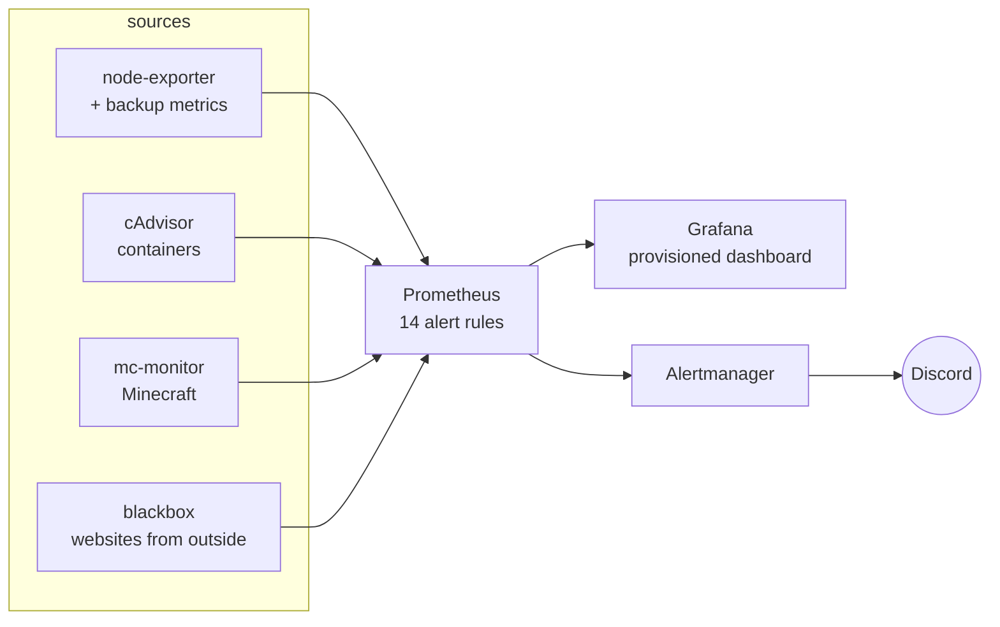

# observatory

Prometheus, Grafana and Alertmanager for my homelab: hosts, containers, backups, a Minecraft server
and public websites in one dashboard, with alerts sent to Discord.
The alert rules are **unit-tested** with `promtool`, so a typo can't silently disable an alert.



## What gets watched

| Area | Alerts |
|---|---|
| Hosts | target down, disk < 10 %, disk full within 24 h (linear prediction), memory > 90 %, CPU > 90 %, OOM kills |
| Backups | no successful backup in 36 h, failed backup, restore test failed or older than 8 days |
| Minecraft | server not responding for 2 min, slow responses |
| Websites | site down, TLS certificate expires in < 14 days, slow responses |

A dead host suppresses its own warning alerts (inhibit rule), so one outage = one message.

## Setup

```bash
./setup.sh                          # .env, Grafana password, Discord webhook
$EDITOR prometheus/targets/*.yml    # your hosts, Minecraft exporters, websites
docker compose up -d
```

Grafana: `http://localhost:3000` (user `admin`, password in `secrets/grafana_admin_password`).
The *Homelab overview* dashboard is provisioned from git and opens as the home page.

Adding a host means one line in `prometheus/targets/nodes.yml`; Prometheus picks it up without a restart.

## Testing

```bash
make check     # promtool + amtool config validation, dashboard JSON
make test      # alert rule unit tests (tests/rules_test.yml)
make validate  # docker compose config
```

All three run in CI on every push.

## Design decisions

- **Config as code, including Grafana.** Datasource and dashboard are provisioned read-only from the repo; the UI can't drift from git.
- **Alert rules have tests.** Each important alert has a promtool test that checks it fires when it should and stays quiet when it shouldn't.
- **Websites are probed from the outside** with blackbox-exporter, which also catches DNS and certificate problems that an internal check would miss.
- **Secrets as files** (`*_FILE` / Docker secrets), UIs bound to `127.0.0.1` by default.
- **File-based service discovery** keeps `prometheus.yml` stable; targets change, the config doesn't.

---

Part of my homelab series → [safekeep](https://github.com/antony-bdc/safekeep) · [dwellers-galaxy](https://github.com/antony-bdc/dwellers-galaxy) · [logwarden](https://github.com/antony-bdc/logwarden) · [antonybdc-status](https://github.com/antony-bdc/antonybdc-status)
